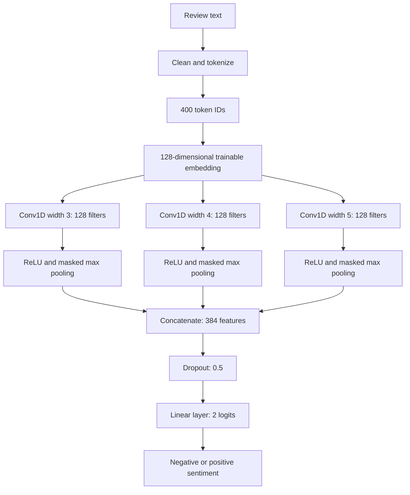
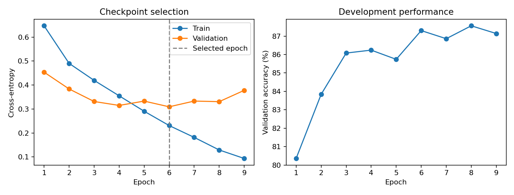
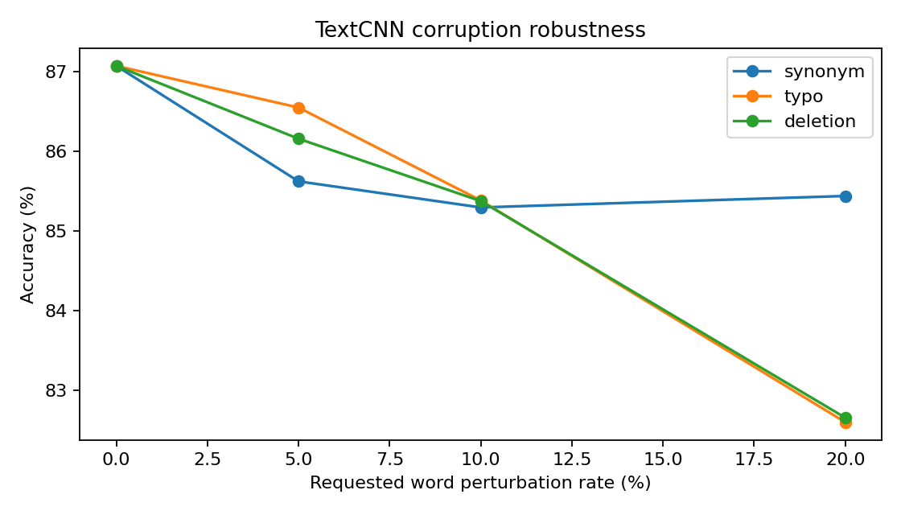
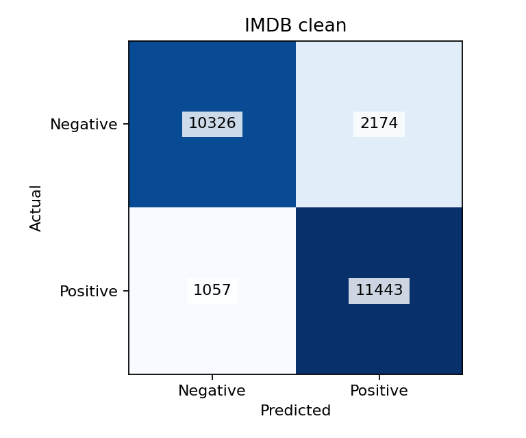
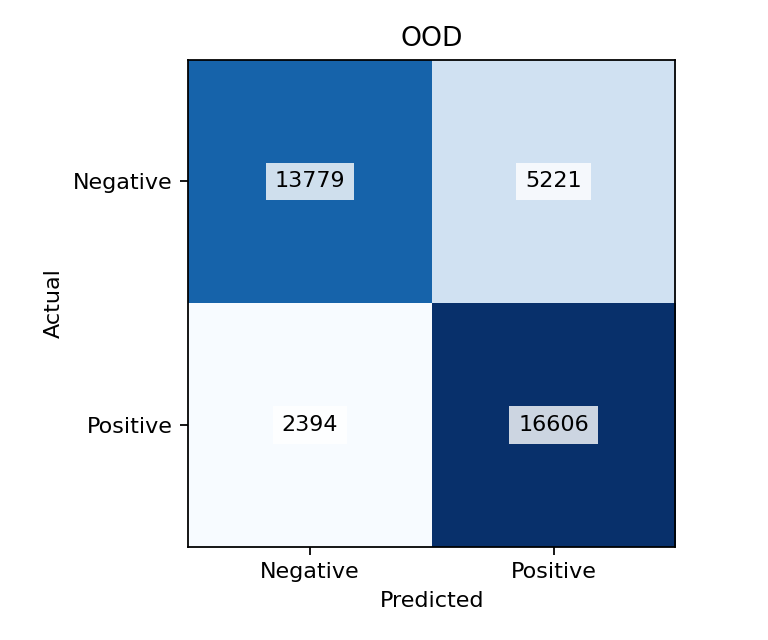

# TextCNN Sentiment Classification and Robustness Evaluation

**Rohit Mohanty · Registration No. 230953168 · ICT 4442 Deep Learning Project**

This repository contains my **TextCNN implementation and evaluation** for the group project **Robustness of Deep Learning Architectures for Sentiment Classification Under Distribution Shift and Adversarial Text Perturbation**. It includes text preprocessing, vocabulary construction, model training, clean and cross-domain evaluation, controlled text perturbations, error analysis, and reproducibility records.

The completed single-seed experiment achieved **87.08% accuracy on 25,000 IMDB test reviews** and **79.96% accuracy on 38,000 Yelp test reviews**. All nine corruption conditions were evaluated using the same validation-selected checkpoint. The package includes **14 passing automated tests**, measured reports, plots, a notebook, and team handoff documentation.

> The interim report listed projected TextCNN scores of 89.3% accuracy and 89.4% macro F1. Those were estimates. The results reported here are measured outputs from the completed experiment.

## Contents

- [Project purpose](#project-purpose)
- [My assigned contribution](#my-assigned-contribution)
- [Repository structure](#repository-structure)
- [Datasets and preprocessing](#datasets-and-preprocessing)
- [TextCNN architecture](#textcnn-architecture)
- [Training configuration](#training-configuration)
- [Evaluation protocol](#evaluation-protocol)
- [Measured results](#measured-results)
- [Robustness experiment design](#robustness-experiment-design)
- [Error analysis and limitations](#error-analysis-and-limitations)
- [Installation](#installation)
- [Using the completed local model](#using-the-completed-local-model)
- [Reproducing the experiment](#reproducing-the-experiment)
- [Outputs and reproducibility](#outputs-and-reproducibility)
- [Testing and continuous integration](#testing-and-continuous-integration)
- [GitHub upload and model sharing](#github-upload-and-model-sharing)
- [Team integration and remaining work](#team-integration-and-remaining-work)
- [Troubleshooting](#troubleshooting)
- [References and acknowledgments](#references-and-acknowledgments)

## Project purpose

The group project compares four architecture families for binary sentiment classification: MLP with TF-IDF, TextCNN, BiLSTM, and DistilBERT. Beyond clean movie-review accuracy, it asks how performance changes when the domain changes or the input contains small textual edits.

This repository supplies the convolutional model's contribution. TextCNN learns local patterns from adjacent word embeddings. Its performance on unfamiliar reviews and corrupted text provides one part of the eventual comparison between local-pattern, sequential, and attention-based architectures.

## My assigned contribution

The synopsis assigns **TextCNN implementation and evaluation** to Rohit Mohanty. The interim report explicitly includes **tokenizer and padding, TextCNN implementation, and preliminary evaluation**. Cross-domain testing, perturbation testing, and final comparative analysis are shared team responsibilities.

| Component | Work included here |
|---|---|
| Preprocessing | HTML break removal, whitespace normalization, tokenization, training-only vocabulary, OOV handling, padding and truncation |
| TextCNN | Embedding layer, parallel convolutions, ReLU, masked global max pooling, dropout and classification head |
| Training | Shared IMDB split, seeded training, validation-based checkpoint selection and early stopping |
| Clean evaluation | Accuracy, macro precision/recall/F1, confusion matrix and per-review predictions |
| Cross-domain evaluation | Evaluation on the complete Yelp Polarity test split without target-domain training |
| Robustness | Synonym substitution, character typos and random word deletion; saved datasets, edit statistics and paired comparisons |
| Analysis | Learning curves, robustness plots, error counts, review-length analysis, vocabulary coverage and duplicate-text audit |
| Reproducibility and handoff | Configuration, split indices, dataset revisions, checksums, environment record, tests, notebook and documentation |

The other model assignments are **Varaang Tiwari: MLP + TF-IDF**, **Arshabrata Bhaumik: BiLSTM**, and **Navneet Vivek: DistilBERT**. This repository does not claim to implement or establish results for those models.

For the mapping to the supplied documents, see [the responsibility guide](docs/YOUR_PART.md) and [completed contribution notes](reports/ROHIT_CONTRIBUTION.md).

## Repository structure

```text
Rohit_230953168_DLProject/
├── README.md                         # Project overview, results and reproduction guide
├── START_HERE.md                     # Short guide for using this completed contribution
├── pyproject.toml                    # Package metadata, dependencies and CLI entry point
├── requirements.txt                  # Editable installation with development dependencies
├── CITATION.cff                      # Software citation metadata
├── .gitignore                       # Excludes local data, weights, caches and environments
├── .gitattributes
├── .github/workflows/tests.yml       # Test workflow for pushes and pull requests
├── configs/baseline.json             # Full TextCNN configuration
├── src/rohit_dl/
│   ├── text.py                       # Cleaning, tokenization, vocabulary and encoding
│   ├── data.py                       # Dataset preparation and persisted split indices
│   ├── model.py                      # TextCNN architecture
│   ├── engine.py                     # Training, evaluation, prediction and metrics
│   ├── perturb.py                    # Deterministic corruption generation
│   ├── robustness.py                 # Paired evaluation suite and comparison exports
│   ├── report.py                     # Shareable report generation and data audit
│   ├── io.py                         # JSON/JSONL validation and checksums
│   ├── smoke.py                      # Synthetic integration check
│   └── cli.py                        # Command-line interface
├── scripts/analyze_errors.py         # Reproduces error counts and length-group metrics
├── tests/test_pipeline.py            # Automated checks
├── notebooks/TextCNN_Walkthrough.ipynb
├── docs/                             # Methods, responsibilities, handoff and viva guides
├── reports/
│   ├── STATUS.md                     # Completed work and remaining joint work
│   ├── ROHIT_CONTRIBUTION.md          # Contribution summary for report integration
│   ├── SEMANTIC_REVIEW.md             # Qualitative corruption inspection
│   ├── verification.json             # Verification record
│   ├── source_checksums.json         # Delivered Python/configuration checksums
│   ├── environment-macos-py39.txt    # Recorded local dependency versions
│   ├── shared_protocol/              # Shared indices, manifests and resource revisions
│   └── textcnn_seed42/                # Measured metrics, plots, audits and error analysis
├── data/                             # Local generated datasets; ignored except README
├── models/                           # Optional local model storage; ignored except README
├── runs/                             # Local trained model and evaluation outputs; ignored
└── references_local/                 # Supplied course documents; ignored
```

Folders containing generated local assets may be absent in a fresh GitHub checkout. The complete local working folder retains them; the GitHub-ready ZIP excludes them.

## Datasets and preprocessing

| Dataset portion | Reviews | Negative / positive | Purpose |
|---|---:|---:|---|
| IMDB training | 20,000 | 10,000 / 10,000 | Fit vocabulary and model |
| IMDB validation | 5,000 | 2,500 / 2,500 | Select checkpoint and apply early stopping |
| Official IMDB test | 25,000 | 12,500 / 12,500 | Clean held-out evaluation |
| Yelp Polarity test | 38,000 | 19,000 / 19,000 | Cross-domain evaluation only |

The 20,000/5,000 development split comes from IMDB's official 25,000-review training portion using stratified sampling and seed **42**. Original row indices are saved so the team can use identical examples. Yelp is the cross-domain option used in the measured run; Amazon Polarity is also supported by the preparation command but was not evaluated in this run.

Preprocessing follows these rules:

1. Replace HTML break tags with spaces, decode HTML entities, and collapse repeated whitespace.
2. Lowercase and tokenize while preserving contractions, negation and punctuation tokens. Do not stem or remove stop words from model input.
3. Build the vocabulary using **training reviews only**, with deterministic frequency ordering and lexical tie-breaking.
4. Use at most **30,000 vocabulary entries**, including `PAD=0` and `UNK=1`.
5. Keep the first **400 tokens** and right-pad shorter inputs with zeros. Map unseen tokens to `UNK`.

Validation, test and Yelp data do not influence vocabulary fitting. No perturbed reviews are mixed into baseline training. The stop-word protection used during corruption generation is separate from model preprocessing.

## TextCNN architecture



Each convolution scans local patterns of a different width. Max pooling retains the strongest activation from each filter, and concatenation combines the three branches. Padding-only and incomplete trailing windows are excluded from pooling; short inputs use a first padded window so even empty input produces finite outputs.

Embeddings are **randomly initialized and trained with the classifier**, not pretrained GloVe vectors. The padding embedding remains zero. The completed model has **4,037,762 parameters**.

Cross-entropy receives the two logits directly. Softmax is used for inference probabilities; a positive probability of at least 0.5 predicts positive. A high probability is not a calibrated guarantee of correctness.

## Training configuration

The complete configuration is saved in [configs/baseline.json](configs/baseline.json).

| Setting | Value |
|---|---|
| Seed | 42 |
| Maximum vocabulary / input length | 30,000 / 400 tokens |
| Embedding dimension | 128 |
| Convolution widths | 3, 4, 5 |
| Filters per width | 128 |
| Dropout | 0.5 |
| Optimizer | Adam |
| Learning rate / weight decay | 0.001 / 0.0 |
| Batch size | 64 |
| Loss | Cross-entropy |
| Gradient norm clipping | 5.0 |
| Maximum epochs | 15 |
| Early-stopping patience | 3 non-improving epochs |
| Checkpoint selection | Minimum validation cross-entropy |
| Actual run | 9 epochs; selected epoch 6; CPU |

Python, NumPy and PyTorch seeds are fixed. Deterministic algorithms are requested with warnings enabled, so identical results across different devices and library versions are not guaranteed. Automatic device selection prefers CUDA, then Apple MPS, then CPU; the recorded experiment used CPU.

Epoch eight had slightly higher validation accuracy than epoch six, but worse validation loss. Epoch six was retained according to the predefined selection rule. Test scores were not used to select the checkpoint.



## Evaluation protocol

All conditions use the same selected checkpoint and fixed preprocessing. Reported measures are:

- **Accuracy:** correctly classified reviews divided by the number evaluated.
- **Macro precision, recall and F1:** unweighted means over negative and positive classes, with undefined divisions set to zero.
- **Confusion matrix:** actual labels in rows, predicted labels in columns, ordered negative then positive.
- **Accuracy drop in percentage points:** `100 × (clean accuracy − condition accuracy)`.
- **Clean-correct failure rate:** for paired corruptions, the fraction of initially correct predictions that become incorrect. This is not a certified adversarial attack success rate.

Yelp uses different examples from IMDB, so its accuracy drop is a domain-level comparison, not a paired statistic. The robustness suite verifies input checksums and the ordered IDs and labels of perturbed reviews before evaluating them.

## Measured results

### Clean and cross-domain evaluation

| Condition | Reviews | Accuracy | Macro precision | Macro recall | Macro F1 | Accuracy drop |
|---|---:|---:|---:|---:|---:|---:|
| IMDB clean | 25,000 | 87.08% | 87.37% | 87.08% | 87.05% | — |
| Yelp cross-domain | 38,000 | 79.96% | 80.64% | 79.96% | 79.85% | 7.12 pp |

### Corruption evaluation

Each row evaluates all **25,000 IMDB test reviews**. Realized rates are the mean fraction of word tokens actually edited, not the requested budget.

| Corruption | Requested rate | Realized rate | Accuracy | Macro F1 | Accuracy drop |
|---|---:|---:|---:|---:|---:|
| Synonym substitution | 5% | 3.73% | 85.62% | 85.60% | 1.45 pp |
| Synonym substitution | 10% | 4.34% | 85.30% | 85.27% | 1.78 pp |
| Synonym substitution | 20% | 4.37% | 85.44% | 85.42% | 1.64 pp |
| Character typo | 5% | 4.68% | 86.55% | 86.54% | 0.52 pp |
| Character typo | 10% | 9.70% | 85.38% | 85.38% | 1.69 pp |
| Character typo | 20% | 19.72% | 82.60% | 82.59% | 4.48 pp |
| Word deletion | 5% | 4.68% | 86.16% | 86.13% | 0.92 pp |
| Word deletion | 10% | 9.70% | 85.38% | 85.34% | 1.70 pp |
| Word deletion | 20% | 19.72% | 82.65% | 82.58% | 4.42 pp |

In total, **11 conditions and 288,000 review instances** were evaluated. Saved metrics were independently recomputed from the prediction files and checked against a common checkpoint checksum. Values above are rounded; accuracy drops were calculated from unrounded scores.

See [the full results](reports/textcnn_seed42/RESULTS.md), [full-precision CSV](reports/textcnn_seed42/summary.csv), and [verification record](reports/verification.json).



**The synonym curve is plotted against requested rates.** Its candidate pool saturates near 4% actual edits. The flatter curve therefore does not demonstrate robustness to 20% actual synonym substitution or establish superiority over the other corruption types at equal intensity.





## Robustness experiment design

The project implements reproducible, model-independent corruption tests:

| Type | Implementation |
|---|---|
| Synonym substitution | nlpaug WordNet candidate backend, restricted to the first sense for contextually tagged base-form adjectives and adverbs; single-word replacements |
| Character typo | Swap unequal adjacent internal characters of eligible words |
| Word deletion | Delete selected eligible words while retaining at least one word |

A deterministic random generator is derived from the seed, review ID, corruption type and rate. The requested edit count is the floor of `rate × word count`, capped by eligible candidates. Explicit negation, contractions, short tokens, English stop words, uppercase acronyms and non-initial capitalized/mixed-case tokens are protected. The protection is heuristic and may also exclude ordinary capitalized words.

Edits are applied to word spans in the cleaned full review. Each resulting review then passes through the standard 400-token encoding. Some edits can therefore occur outside the portion visible to the model. Different rates have separately seeded selections, rather than guaranteed nested edit sets.

Generated files retain review IDs and labels and record requested rates, realized rates and edit counts. The semantic review CSV samples 30 reviews per condition. Nine examples received an **AI-assisted qualitative spot check**; the remaining 261 entries are available for independent review. The spot check is a convenience sample, not a representative human annotation study. No examples were removed based on model outcomes.

These tests do **not** implement TextFooler, HotFlip, or optimized model-query attacks. Synonyms and deletions can alter meaning, so unchanged sentiment is an assumption to inspect rather than a guaranteed property. See [the semantic review](reports/SEMANTIC_REVIEW.md).

## Error analysis and limitations

The observed domain gap is **7.12 percentage points**. At about 19.72% realized edits, typo and deletion accuracy drops are **4.48** and **4.42 points**. Their near-equal drops in one run do not establish a meaningful difference between the corruption types.

The error audit found:

- More false positives than false negatives: **2,174 vs 1,057** on IMDB and **5,221 vs 2,394** on Yelp.
- Lower accuracy for reviews longer than 400 tokens: **82.95%** on IMDB and **77.22%** on Yelp. This association alone does not establish that truncation caused the difference.
- Pre-truncation OOV token rates of **1.99%** on IMDB test and **4.45%** on Yelp. Vocabulary mismatch is a possible contributor, not an isolated causal explanation.
- Exact cleaned-text overlap already present in the benchmark. Excluding **123 test rows** that match training or validation leaves **24,877 rows** and **87.05% accuracy**, versus 87.08% on the official full test set.

Qualitative inspection includes mixed sentiment, a review praising a chain but criticizing one location, unfamiliar-domain wording, and a possible dataset label/text inconsistency. These are illustrative cases, not proven explanations of the model's internal decisions. Official labels were retained.

The main limits are a single training seed, one architecture, random rather than pretrained embeddings, 400-token truncation, heuristic semantic protection, unequal realized corruption intensity, and existing dataset duplication. The results do not establish architecture superiority, statistical significance or production readiness.

Read [the error analysis](reports/textcnn_seed42/ERROR_ANALYSIS.md), [error counts](reports/textcnn_seed42/error_summary.json), and [data audit](reports/textcnn_seed42/data_audit.json).

## Installation

Run commands from the repository root. The package declares **Python 3.9+** support; the completed local run used **Python 3.9.6, PyTorch 2.8.0 and macOS arm64 CPU**. Python 3.11 is the version configured for GitHub CI.

### macOS or Linux

```bash
python3 -m venv .venv
source .venv/bin/activate
python -m pip install --upgrade pip
python -m pip install -e '.[dev]'
```

### Windows PowerShell

```powershell
py -m venv .venv
.venv\Scripts\Activate.ps1
python -m pip install --upgrade pip
python -m pip install -e ".[dev]"
```

Dependencies include PyTorch, NumPy, scikit-learn, Hugging Face Datasets, Matplotlib, NLTK and nlpaug. Pytest is included in the development extra. Their declarations are in [pyproject.toml](pyproject.toml); the exact observed local versions are in [the environment record](reports/environment-macos-py39.txt). That record is not a guarantee of identical behavior on every operating system.

Check the installation:

```bash
rohit-dl --help
python -m pytest -q
rohit-dl smoke --output runs/smoke
```

The smoke run uses tiny repeated synthetic examples to check integration. **Its scores are not IMDB results.** Use a new output directory if a smoke run already exists.

## Using the completed local model

The full local working folder includes `runs/textcnn_seed42/`. After installing the package, inference requires no dataset download:

```bash
rohit-dl predict --run runs/textcnn_seed42 --text "The acting was excellent, but the story was not convincing."
```

To force CPU inference, append `--device cpu`. The command returns a sentiment label and positive-class probability.

A fresh GitHub checkout or the GitHub-ready ZIP does **not** contain this run folder. Train a model using the steps below, or obtain the complete run folder from an agreed model artifact location. Keep `best.pt`, `vocab.json`, `config.json`, and `training_complete.json` together for loading; preserve the entire run folder for evaluation and provenance.

## Reproducing the experiment

These commands use new `reproduced` output names to preserve the committed measured reports and the delivered local run. On an already completed local copy, skip preparation steps for existing data and choose fresh run/output names for repeats. Commands protect existing data, training, evaluation and report directories from overwrite.

### 1. Prepare the data

```bash
rohit-dl prepare --output data --ood yelp
```

This downloads the datasets and writes `train.jsonl`, `validation.jsonl`, `test.jsonl`, `ood.jsonl`, split indices and a manifest. Internet access and space for datasets and caches are needed for initial preparation. Subsequent training uses the saved local files.

Each JSONL row has a unique string `id`, string `text`, and integer `label`: **0 = negative**, **1 = positive**. See [shared protocol metadata](reports/shared_protocol/README.md) for the actual indices, fingerprints, revisions and checksums used in the recorded run. `prepare --revision COMMIT` can pin the IMDB revision. The measured run used the full Yelp test set; using `--ood-limit` or `--ood amazon` defines a different evaluation condition.

### 2. Train TextCNN

```bash
rohit-dl train --data data --run runs/textcnn_reproduced --config configs/baseline.json
```

For a different device, copy the configuration and change `device` to `cpu`, `cuda` or `mps`, then pass that file with `--config`. Record any configuration changes as a new experiment. Keep test and OOD results out of model-selection decisions.

### 3. Generate the corruption datasets

Download the language resources:

```bash
python -m nltk.downloader -d .cache/nltk_data wordnet averaged_perceptron_tagger_eng
```

Set the resource path in the current shell:

```bash
# macOS / Linux
export NLTK_DATA="$PWD/.cache/nltk_data"
```

```powershell
# Windows PowerShell
$env:NLTK_DATA="$PWD/.cache/nltk_data"
```

Then generate all nine conditions:

```bash
rohit-dl perturb --input data/test.jsonl --output data/perturbed --rates 0.05 0.10 0.20
```

Inspect `data/perturbed/manifest.json` for actual edit rates and `semantic_review.csv` for qualitative checks. Share these exact generated reviews with teammates for a fair cross-model comparison.

### 4. Evaluate clean, OOD and corrupted inputs

```bash
rohit-dl robustness --run runs/textcnn_reproduced --clean data/test.jsonl --perturbed data/perturbed --ood data/ood.jsonl --output runs/robustness_reproduced
```

This includes the clean test evaluation, so a separate clean run is optional. To evaluate a single dataset independently:

```bash
rohit-dl evaluate --run runs/textcnn_reproduced --input data/test.jsonl --output runs/clean_reproduced --name "IMDB clean"
```

### 5. Export reports and reproduce error summaries

```bash
rohit-dl report --run runs/textcnn_reproduced --suite runs/robustness_reproduced --data data --output reports/textcnn_reproduced
python scripts/analyze_errors.py --suite runs/robustness_reproduced --output reports/textcnn_reproduced/error_summary.json
```

The report command exports measured metrics, plots, configuration/provenance, and a data audit. The descriptive error-analysis script reproduces class-direction counts and accuracy by original review length. Qualitative interpretation remains a separate review of the saved examples.

### Notebook workflow

[TextCNN_Walkthrough.ipynb](notebooks/TextCNN_Walkthrough.ipynb) provides a guided interface to the same package. Place the entire project folder in the notebook environment first. The notebook is intentionally unexecuted, uses the standard run names, and should be adjusted or skipped where local outputs already exist. Preserve run files before ending a temporary notebook runtime.

## Outputs and reproducibility

| Output | Meaning |
|---|---|
| `best.pt` | Validation-selected model weights |
| `vocab.json` and `config.json` | Exact tokenizer vocabulary and model/training settings |
| `history.json` and `best_validation.json` | Epoch history and selected checkpoint's validation metrics |
| `training_complete.json` | Completed-run marker and training duration |
| `provenance.json` | Environment, device, counts, parameter count and input/configuration hashes |
| `development_ids.json` | Training/validation IDs used to guard against accidental held-out evaluation overlap |
| Per-condition `metrics.json` | Metrics plus input and checkpoint hashes |
| Per-condition `predictions.jsonl` | IDs, text, labels, predictions and positive probabilities |
| Per-condition `errors.jsonl` | Misclassified examples ordered by confidence |
| `summary.csv` and `summary.json` | Cross-condition results, drops, paired failures and realized edit rates |
| `data_audit.json` | Class counts, OOV/truncation rates, duplicates and overlap sensitivity |
| `error_summary.json` | Error direction counts and review-length analysis |

Committed evidence for the completed experiment is in [reports/textcnn_seed42](reports/textcnn_seed42/). Local large outputs are under `runs/textcnn_seed42/` and `runs/robustness_seed42/`. Dataset/resource checksums are in [reports/shared_protocol](reports/shared_protocol/), and Python/configuration hashes are in [source_checksums.json](reports/source_checksums.json).

## Testing and continuous integration

Run:

```bash
python -m pytest -q
```

The recorded local suite passed **14 tests**, covering training-only vocabulary behavior, negation/contraction preservation, padding and truncation, split reproducibility and isolation, model shapes/gradients/padding invariance, metric edge cases, deterministic corruptions, protected tokens, checkpoint reload, evaluation overlap and overwrite guards, checksum/ID validation, and report/data-audit generation.

The saved evaluation metrics were also recomputed from all **288,000 predictions**, and the error summary was reproduced independently. All four final plots were visually checked. See [verification.json](reports/verification.json).

[The GitHub Actions workflow](.github/workflows/tests.yml) is configured to install the package and run tests on push and pull request. It does not download benchmark datasets or run full training. A configured workflow is not a claim that a remote GitHub run has already passed. If this project is nested inside the group repository, adapt the workflow's working directory and dependency-cache path.

## GitHub upload and model sharing

The repository is organized so that `git add .` selects source, tests, configuration, notebook, documentation, small reports and shared protocol metadata. The existing `.gitignore` excludes:

- Virtual environments, caches, generated Python files and build artifacts.
- Raw/generated datasets and per-example run outputs.
- Trained model files under `runs/` and `models/`.
- The locally preserved course Word documents and `.env` files.

**The full project implementation and measured summaries are ready for Git; the complete local working folder also contains assets that Git intentionally ignores.** To share the trained model, package the complete `runs/textcnn_seed42/` directory and attach it to an agreed GitHub Release or model artifact store. Document its download location when available. Use the dataset acquisition commands for raw data, or an agreed shared data location for the exact perturbed reviews. Do not assume the GitHub-ready ZIP includes weights or datasets.

For a new standalone repository, from this folder:

```bash
git init
git add .
git status --short
git diff --cached --stat
git commit -m "Add TextCNN sentiment classification and robustness evaluation"
git branch -M main
```

After creating or selecting the intended GitHub repository, replace the placeholder with its real URL:

```bash
git remote add origin YOUR_REPOSITORY_URL
git push -u origin main
```

If a repository or remote already exists, inspect it with `git status` and `git remote -v` and use the group's existing branch/merge process. Do not blindly reinitialize or replace an existing remote. See [the GitHub guide](docs/GITHUB_GUIDE.md) for the group-repository alternative.

No open-source license is assigned by this package. Agree licensing with the team before granting public reuse permissions. Repository visibility and publishing decisions belong to the project team.

## Team integration and remaining work

To combine this contribution with the other models:

1. Reconcile and adopt the same IMDB train/validation indices and label mapping.
2. Use the same clean test reviews, Yelp selection and saved perturbation sets.
3. Keep learned feature construction training-only for every model; model-specific tokenization can still differ.
4. Merge each member's measured results using the condition, seed, sample count and metric definitions in this repository.
5. Review semantic validity and discuss actual edit rates, truncation and dataset limitations.
6. Use the joint evidence to write the final comparison, report and presentation.

The TextCNN implementation, training and evaluations are complete. Remaining joint work includes protocol reconciliation, the other models' measured rows, broader semantic review where needed, and the final group synthesis. A single-model result cannot answer which architecture is most robust.

Further guides: [methods](docs/METHODS.md), [team handoff](docs/TEAM_HANDOFF.md), [viva preparation](docs/VIVA_GUIDE.md), [contribution notes](reports/ROHIT_CONTRIBUTION.md), and [completion status](reports/STATUS.md).

## Troubleshooting

| Symptom | Action |
|---|---|
| `rohit-dl` is not found | Activate the environment and run `python -m pip install -e '.[dev]'` from the project root. |
| A data/run/output directory already exists | Reuse completed assets where appropriate, skip that step, or choose a fresh output path. Preserve measured reports. |
| WordNet or POS tagger is missing | Run the NLTK download command and set `NLTK_DATA` in the shell that launches perturbation generation. |
| GPU or MPS operation fails | Use a configuration with `device: "cpu"` for training or `--device cpu` for evaluation/inference. |
| A fresh GitHub clone has no checkpoint | Train the model or obtain the complete run folder from the team's artifact location. Weights are intentionally not committed. |
| Perturbed data fails checksum or ID checks | Use the corruption set generated from the same clean file; do not mix independently ordered or edited datasets. |
| Rerun scores differ | Check dataset revisions, shared indices, configuration, package versions, device and seeds; cross-platform bitwise reproducibility is not promised. |

## References and acknowledgments

- Yoon Kim. 2014. [Convolutional Neural Networks for Sentence Classification](https://aclanthology.org/D14-1181/).
- Andrew L. Maas and colleagues. 2011. *Learning Word Vectors for Sentiment Analysis*. [IMDB dataset](https://huggingface.co/datasets/stanfordnlp/imdb).
- [Yelp Polarity dataset](https://huggingface.co/datasets/fancyzhx/yelp_polarity).
- [PyTorch Conv1D documentation](https://docs.pytorch.org/docs/stable/generated/torch.nn.Conv1d.html).
- [nlpaug](https://github.com/makcedward/nlpaug) and [NLTK WordNet documentation](https://www.nltk.org/howto/wordnet.html).

The supplied project synopsis and interim report define the assignment and required TextCNN configuration. Their original copies are preserved in the local, ignored `references_local/` folder. Implementation choices beyond those requirements are documented in [YOUR_PART.md](docs/YOUR_PART.md).

This package was prepared with AI assistance for implementation, documentation and qualitative inspection. Interpret its evidence critically, understand the code before presenting it, and follow the course's acknowledgment requirements. Use [CITATION.cff](CITATION.cff) for this software's citation metadata and cite the original research separately.
