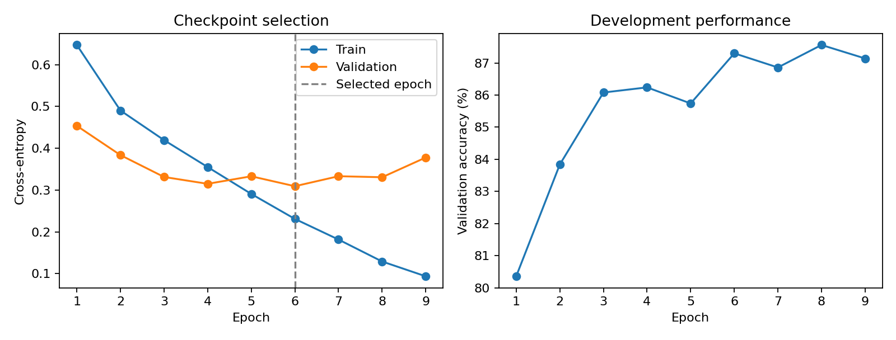
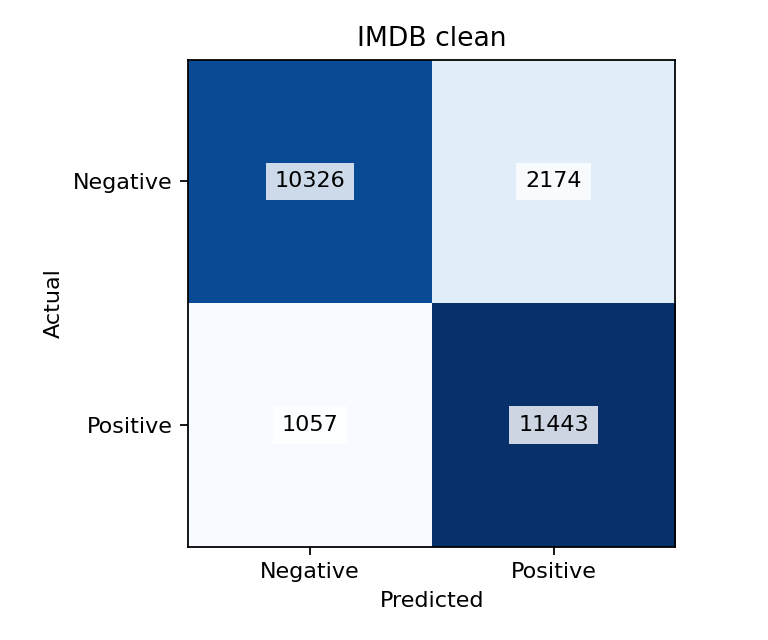
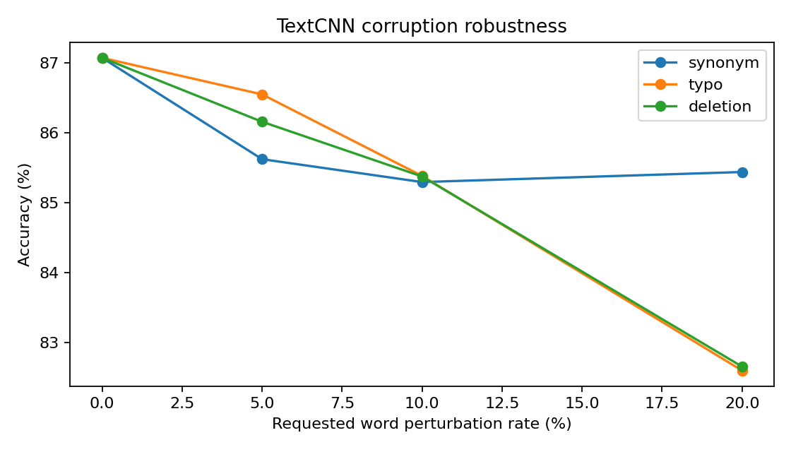

# Measured TextCNN results

Rohit Mohanty — ICT 4442

Training used 20,000 IMDB reviews and 5,000 validation reviews. The selected checkpoint is epoch 6 of 9 completed epochs, selected by minimum validation loss. Device: cpu. Training seed: 42. Parameters: 4,037,762.

These are measured single-run results. The interim report projections are not used as evidence.

| Condition | Requested rate | Realized rate | N | Accuracy % | Macro precision % | Macro recall % | Macro F1 % | Drop pp |
|---|---:|---:|---:|---:|---:|---:|---:|---:|
| clean | — | — | 25,000 | 87.08 | 87.37 | 87.08 | 87.05 | 0.00 |
| ood | — | — | 38,000 | 79.96 | 80.64 | 79.96 | 79.85 | 7.12 |
| synonym | 5% | 3.73% | 25,000 | 85.62 | 85.86 | 85.62 | 85.60 | 1.45 |
| synonym | 10% | 4.34% | 25,000 | 85.30 | 85.52 | 85.30 | 85.27 | 1.78 |
| synonym | 20% | 4.37% | 25,000 | 85.44 | 85.67 | 85.44 | 85.42 | 1.64 |
| typo | 5% | 4.68% | 25,000 | 86.55 | 86.70 | 86.55 | 86.54 | 0.52 |
| typo | 10% | 9.70% | 25,000 | 85.38 | 85.42 | 85.38 | 85.38 | 1.69 |
| typo | 20% | 19.72% | 25,000 | 82.60 | 82.67 | 82.60 | 82.59 | 4.48 |
| deletion | 5% | 4.68% | 25,000 | 86.16 | 86.50 | 86.16 | 86.13 | 0.92 |
| deletion | 10% | 9.70% | 25,000 | 85.38 | 85.76 | 85.38 | 85.34 | 1.70 |
| deletion | 20% | 19.72% | 25,000 | 82.65 | 83.22 | 82.65 | 82.58 | 4.42 |

Synonym candidates saturate: the requested 20% condition actually changes 4.37% of words on average. Do not read the flatter synonym curve as evidence of robustness to 20% actual substitution. The full realized rates appear in the table above.

See [error analysis](ERROR_ANALYSIS.md) for inspected examples and [semantic review](../SEMANTIC_REVIEW.md) for the assisted spot check.

## Interpretation limits

The corruption tests are seeded, model-independent edits. Their inherited labels assume unchanged sentiment, which is not guaranteed. Human semantic review is still needed before treating the perturbation rows as label-preserving adversarial robustness results. Clean and OOD evaluations use their benchmark labels.

The model uses the first 400 tokens. Some generated edits lie beyond that window. This is one seed and one architecture; no superiority claim over the teammates' models follows until their measured results use the same protocol.

The data audit reports existing exact-text duplicates and overlaps without changing the specified official split. These can make evaluation optimistic. Any deduplicated sensitivity analysis must be a separate team-agreed experiment, not an undisclosed change to these benchmark results.

After excluding 123 test rows whose cleaned text matches training or validation, the same checkpoint scores 87.05% accuracy on 24,877 retained rows. This sensitivity check does not replace the official test result.

## Reproducibility

Checkpoint SHA-256: `2ac6eb6f8956266aee1c274371bb6a1484c82e3526ca99af81d29347295a51c8`.

See configuration, provenance, dataset manifest, training history, data audit and the full-precision summary CSV in this folder. The raw predictions and model checkpoint remain under the local run directory and are ignored by Git.

